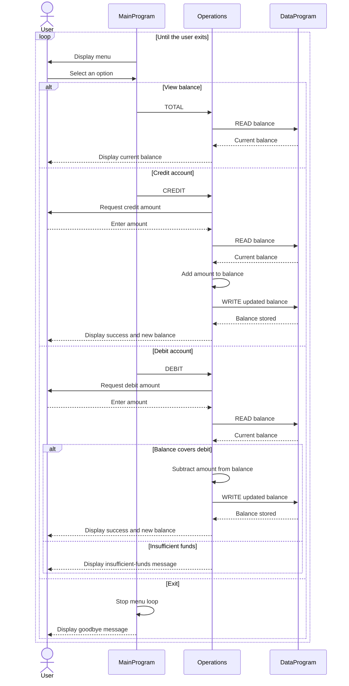

# COBOL Student Account Management

This directory documents the COBOL account-management example in `src/cobol/`. The program provides a console interface for viewing an account balance, crediting funds, and debiting funds. The COBOL code does not store student identity or enrollment details; "student account" refers to the account balance managed by this example.

## Source files

### `main.cob` - `MainProgram`

Provides the interactive menu and dispatches account actions to `Operations`.

- Displays options to view the balance, credit the account, debit the account, or exit.
- Sends `TOTAL`, `CREDIT`, or `DEBIT` to `Operations` based on the user's selection.
- Repeats until the user selects Exit; other menu choices display an invalid-choice message.

### `operations.cob` - `Operations`

Implements account actions and communicates with `DataProgram` to read or update the balance.

- `TOTAL`: reads and displays the current balance.
- `CREDIT`: accepts an amount, adds it to the current balance, saves the result, and displays the new balance.
- `DEBIT`: accepts an amount and subtracts it only when the current balance is at least that amount; otherwise it displays an insufficient-funds message.

### `data.cob` - `DataProgram`

Provides the account balance storage interface. Its `READ` operation copies the stored balance to the caller, and its `WRITE` operation replaces the stored balance with the value supplied by the caller. The balance starts at `1000.00`.

## Account rules and limits

- The initial balance is `1000.00`.
- Balances and transaction amounts use `PIC 9(6)V99`: up to six whole-number digits and two decimal digits. The `V` is an implied decimal point.
- Credits increase the balance by the entered amount.
- Debits are allowed when the balance is greater than or equal to the entered amount. A debit that exceeds the balance is rejected without changing it.
- The program does not currently enforce student-specific rules such as student identity, tuition limits, fees, or enrollment status.
- The program does not explicitly reject zero or negative transaction amounts, validate malformed input, or report overflow. Those cases are not defined as supported business rules in the current implementation.

## Runtime flow

`MainProgram` calls `Operations` with an action. `Operations` uses `DataProgram` to read the balance and, after a successful credit or debit, write the updated balance. The balance is held in COBOL working storage; this example does not persist it to a file or database.

## Sequence diagram

